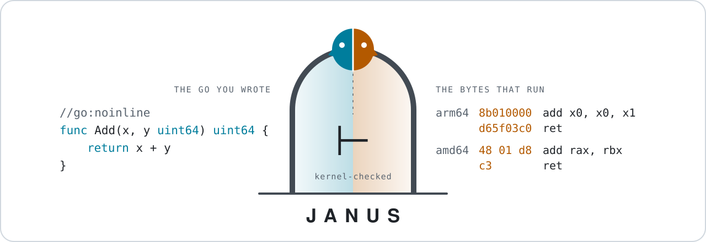

<p align="center">
  <picture>
    <source media="(prefers-color-scheme: dark)" srcset="docs/assets/banner.svg">
    <source media="(prefers-color-scheme: light)" srcset="docs/assets/banner-light.svg">
    
  </picture>
</p>

<p align="center">
  <b>Machine-checked proofs about compiled Go, against the arm64 and amd64 machine code in the ELF binary.</b>
</p>

<p align="center">
  <a href="https://github.com/Giulio2002/Janus/actions/workflows/ci.yml"></a>
  
  
  
</p>

Janus is a Lean 4 framework for proving theorems about Go functions **as compiled**. It copies the
instruction bytes of a function out of a linux/arm64 or linux/amd64 Go executable, decodes and runs
them in a Lean model of the ISA, and checks your proof with the Lean kernel. The Go compiler and
linker are not trusted: the theorem is about the bytes that will execute.

The name: Janus is the two-faced Roman god of doorways. One face looks at the Go program you wrote,
the other at the machine code that runs. Janus is the Go counterpart of
[LeanCIL](https://github.com/NethermindEth/LeanCIL), which does the same for .NET.

> **Status:** early work in progress. The model covers the user-mode integer subset that Go
> emits (on arm64 also the Advanced SIMD integer, move and AES instructions of the runtime's
> `memequal`/`IndexByte`/`Count`/hash routines), and the scalar `float32`/`float64` instructions
> on both ISAs, bit-exact on a shared IEEE 754 core; anything else faults rather than being guessed (see [limits](#what-a-verified-result-means)).

---

## In 30 seconds

```go
//go:noinline
func Add(x, y uint64) uint64 { return x + y }     // examples/basic/basic.go
```

```lean
theorem correctness (x y : BitVec 64) :                        -- examples/proofs/Add.lean
    Ensures Extracted.program Extracted.entry [x, y] (fun _ => True)
      (fun _ s' => (s'.regs 0).toNat = (x.toNat + y.toNat) % 2 ^ 64) := by
  intro ret hret s hs _
  janus_intro hs
  janus_run
```

```console
$ bin/janus extract artifacts/examples-arm64 example.com/basic.Add artifacts/Add
Extracted example.com/basic.Add: 1 function(s), 2 word(s), 0 stub(s), 0 data object(s) (0 bytes) into artifacts/Add/Extracted.lean
  code  0x930c0    2 words  example.com/basic.Add
$ bin/janus verify artifacts/Add --proof examples/proofs/Add.lean
Verified: Proof.correctness
  Module: example.com/basic (go1.26.0)
  Entry: example.com/basic.Add at 0x930c0
  Binary: artifacts/examples-arm64 (SHA-256 70feac5b263a686c7e3db19e05519ce3829e835c9164384bde284dd0e52b6422)
  Proof: examples/proofs/Add.lean
  Framework: embedded (SHA-256 e9be8cd3d7116073ba456dd933bd277edd8d3ce37bf8acb842c28f43decccbba, 30 files, leanprover/lean4:v4.34.1)
  Sandbox: bubblewrap (no network, read-only filesystem, private build dir)
  Axioms: Classical.choice, Quot.sound, propext
  Kernel replay: leanchecker passed (Extracted, Janus, Janus.Amd64, Janus.Amd64.Decode, Janus.Amd64.Exec, Janus.Amd64.GoABI, Janus.Amd64.Instr, Janus.Amd64.Program, Janus.Amd64.Run, Janus.Amd64.State, … and 19 more; 29 modules; 26 reused from the replay cache)
  Lean: Lean (version 4.34.1, x86_64-unknown-linux-gnu, commit 5045d0056413266e57c625dcd7c365b10e377c52, Release)
  Report: artifacts/Add/verified.json
  Statement:
    Proof.correctness (x y : BitVec 64) : Janus.GoABI.Ensures Extracted.program Extracted.entry [x, y] (fun x => True) fun x_1 s' => BitVec.toNat (s'.regs 0) = (x.toNat + y.toNat) % 2 ^ 64
```

**What that line means.** For all 64-bit `x` and `y`, for every machine state that is a Go call of
the function at `0x930c0` (any admissible return address in `X30`; every other register, the flags,
the stack pointer and all of memory arbitrary), the two words `0x8b010000 0xd65f03c0` copied from the
binary return to the caller after finitely many steps, never fault or panic, preserve the
callee-saved state, and leave `(x + y) mod 2^64` in `X0`. The printed statement is the one the kernel
checked, printed in an environment the proof cannot influence.

The run above takes about 17 s on a warm cache (framework built, its kernel replay cached); most of it
is the sandboxed Lean build of the proof and the audit. The first verification per framework version
also replays every framework module (about 10 s more).

## How it works

1. `go build` produces a linux/arm64 or amd64 ELF binary (the compiler is not trusted).
2. `janus extract` copies the raw instruction words or bytes of your function, its callees and the read-only data they load into `Extracted.lean`, and records the binary's SHA-256.
3. Lean decodes and runs those bytes in a model of the ISA. Every step gives a state or a named fault; memory access outside the granted regions faults.
4. You state a theorem (`Ensures`: the code returns to any caller, with a given postcondition) and prove it. The proof is treated as hostile code.
5. `janus verify` re-extracts and byte-compares, builds the proof in a sandbox, audits the statement, allows only the standard axioms, and replays everything with the Lean kernel checker. It writes `verified.json`.

The trusted parts are the byte copy, the ISA models and the verifier with the Lean kernel. Details and the flow diagram: [docs/design/ARCHITECTURE.md](docs/design/ARCHITECTURE.md).

## Install and quick start

Release binaries (v0.2.0: linux amd64 and arm64) are at <https://github.com/Giulio2002/Janus/releases>. To build from source you need Go 1.26, [elan](https://github.com/leanprover/elan) (installs Lean 4.34.1 from `lean-toolchain`) and bubblewrap for the sandbox (`apt-get install -y bubblewrap`).

```sh
git clone https://github.com/Giulio2002/Janus && cd Janus
go build -o bin/janus ./cmd/janus                    # the Lean framework is embedded in the binary
scripts/build/build-examples.sh                      # builds artifacts/examples-arm64
bin/janus extract artifacts/examples-arm64 example.com/basic.Add artifacts/Add
bin/janus verify artifacts/Add --proof examples/proofs/Add.lean
```

The first `verify` builds the embedded framework once under `~/.cache/janus`. New to Janus? [docs/TUTORIAL.md](docs/TUTORIAL.md) goes from an empty directory to a verified theorem about your own function. All commands: [docs/CLI.md](docs/CLI.md#command-summary).

## What a Verified result means

A `Verified:` line means the printed statement, with its hypotheses and quantifiers, holds for the exact bytes of this binary under the Lean model. The kernel checks the proof, **not whether the statement says what you meant**: read the statement, and beware an unsatisfiable precondition (the theorem is then vacuous).

It says nothing about another build or compiler version, timing and side channels, concurrency (the model is single-threaded), or instructions outside the modelled subset (these fault as `undecodable`). You trust the ISA models (tested against qemu, Arm's Sail model, TestFloat and real x86 hardware, with 0 mismatches: [docs/MODEL-VALIDATION.md](docs/MODEL-VALIDATION.md)), the byte copy and the verifier. The proof file is not trusted.

Full tables: [docs/SECURITY.md](docs/SECURITY.md) (trusted base, meaning, sandbox and audit defences) and [docs/SOUNDNESS.md](docs/SOUNDNESS.md).

## Who uses it

[fv-uint256](https://github.com/Giulio2002/fv-uint256) verifies all 146 functions of holiman/uint256 as compiled arm64 and amd64 code with Janus. See also [docs/CONSUMERS.md](docs/CONSUMERS.md).

## Documentation

| Document | Contents |
|---|---|
| [Structure/README.md](Structure/README.md) | Repository map: every folder in plain English |
| [docs/TUTORIAL.md](docs/TUTORIAL.md) | Your first proof, step by step |
| [docs/PROOFS.md](docs/PROOFS.md) | Writing proofs: `janus_run`, the spec vocabulary, loops, calls, aliasing |
| [docs/EXAMPLES.md](docs/EXAMPLES.md) | Break-it demo and what the shipped examples prove |
| [docs/CLI.md](docs/CLI.md) | Every command, artifact format and diagnostic |
| [docs/CONSUMERS.md](docs/CONSUMERS.md) | Proofs in your own Lake package, batch verification, caches |
| [docs/SOUNDNESS.md](docs/SOUNDNESS.md), [docs/SECURITY.md](docs/SECURITY.md) | Trusted base, exact meaning of a theorem, defences against hostile proofs |
| [docs/design/ARCHITECTURE.md](docs/design/ARCHITECTURE.md) | Module map, data flow, the program/state/outcome model |
| [docs/RUNTIME-CONTRACTS.md](docs/RUNTIME-CONTRACTS.md) | Runtime calls and dynamic calls (interfaces, closures, `defer`) |
| [docs/AMD64.md](docs/AMD64.md), [docs/FFI.md](docs/FFI.md), [docs/ABI0.md](docs/ABI0.md) | The x86-64 backend, Go calling C, Go assembly |
| [docs/MODEL-VALIDATION.md](docs/MODEL-VALIDATION.md), [docs/validation/](docs/validation/ORACLE.md) | How the ISA models are tested against references |
| [docs/audit/AUDIT.md](docs/audit/AUDIT.md) | The red-team audit of `janus verify` and its fixes |

## License

Janus is released under the [MIT License](LICENSE).
