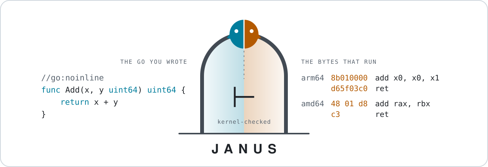
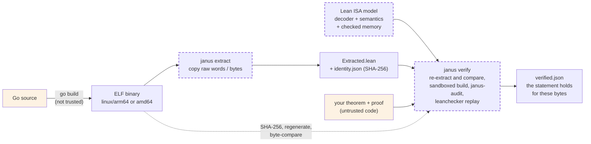

<p align="center">
  <picture>
    <source media="(prefers-color-scheme: dark)" srcset="assets/banner.svg">
    <source media="(prefers-color-scheme: light)" srcset="assets/banner-light.svg">
    
  </picture>
</p>

<p align="center">
  <b>Machine-checked proofs about compiled Go, against the arm64 and amd64 machine code in the ELF binary.</b>
</p>

<p align="center">
  <a href="https://github.com/Giulio2002/Janus/actions/workflows/ci.yml"></a>
  
  
  
</p>

Janus is a Lean 4 framework for proving theorems about Go functions **as compiled**. It copies the
instruction bytes of a function out of a linux/arm64 or linux/amd64 Go executable, decodes and runs
them in a Lean model of the ISA, and checks your proof with the Lean kernel. The Go compiler and
linker are not trusted: the theorem is about the bytes that will execute.

The name: Janus is the two-faced Roman god of doorways. One face looks at the Go program you wrote,
the other at the machine code that runs. Janus is the Go counterpart of
[LeanCIL](https://github.com/NethermindEth/LeanCIL), which does the same for .NET.

> **Status:** early work in progress. The model covers the user-mode integer subset that Go
> emits (on arm64 also the Advanced SIMD integer, move and AES instructions of the runtime's
> `memequal`/`IndexByte`/`Count`/hash routines); anything else faults rather than being guessed (see [limits](#what-a-verified-theorem-does-and-does-not-mean)).

---

## In 30 seconds

```go
//go:noinline
func Add(x, y uint64) uint64 { return x + y }     // examples/basic/basic.go
```

```lean
theorem correctness (x y : BitVec 64) :                        -- examples/proofs/Add.lean
    Ensures Extracted.program Extracted.entry [x, y] (fun _ => True)
      (fun _ s' => (s'.regs 0).toNat = (x.toNat + y.toNat) % 2 ^ 64) := by
  intro ret hret s hs _
  janus_intro hs
  janus_run
```

```console
$ bin/janus extract artifacts/examples-arm64 example.com/basic.Add artifacts/Add
Extracted example.com/basic.Add: 1 function(s), 2 word(s), 0 stub(s), 0 data object(s) (0 bytes) into artifacts/Add/Extracted.lean
  code  0x930c0    2 words  example.com/basic.Add
$ bin/janus verify artifacts/Add --proof examples/proofs/Add.lean
Verified: Proof.correctness
  Module: example.com/basic (go1.26.0)
  Entry: example.com/basic.Add at 0x930c0
  Binary: artifacts/examples-arm64 (SHA-256 70feac5b263a686c7e3db19e05519ce3829e835c9164384bde284dd0e52b6422)
  Proof: examples/proofs/Add.lean
  Framework: embedded (SHA-256 e9be8cd3d7116073ba456dd933bd277edd8d3ce37bf8acb842c28f43decccbba, 30 files, leanprover/lean4:v4.34.1)
  Sandbox: bubblewrap (no network, read-only filesystem, private build dir)
  Axioms: Classical.choice, Quot.sound, propext
  Kernel replay: leanchecker passed (Extracted, Janus, Janus.Amd64, Janus.Amd64.Decode, Janus.Amd64.Exec, Janus.Amd64.GoABI, Janus.Amd64.Instr, Janus.Amd64.Program, Janus.Amd64.Run, Janus.Amd64.State, … and 19 more; 29 modules; 26 reused from the replay cache)
  Lean: Lean (version 4.34.1, x86_64-unknown-linux-gnu, commit 5045d0056413266e57c625dcd7c365b10e377c52, Release)
  Report: artifacts/Add/verified.json
  Statement:
    Proof.correctness (x y : BitVec 64) : Janus.GoABI.Ensures Extracted.program Extracted.entry [x, y] (fun x => True) fun x_1 s' => BitVec.toNat (s'.regs 0) = (x.toNat + y.toNat) % 2 ^ 64
```

**What that line means.** For all 64-bit `x` and `y`, for every machine state that is a Go call of
the function at `0x930c0` (any admissible return address in `X30`; every other register, the flags,
the stack pointer and all of memory arbitrary), the two words `0x8b010000 0xd65f03c0` copied from the
binary return to the caller after finitely many steps, never fault or panic, preserve the
callee-saved state, and leave `(x + y) mod 2^64` in `X0`. The printed statement is the one the kernel
checked, printed in an environment the proof cannot influence.

The run above takes about 17 s on a warm cache (framework built, its kernel replay cached); most of it
is the sandboxed Lean build of the proof and the audit. The first verification per framework version
also replays every framework module (about 10 s more).

## How it works



Dashed boxes are **trusted** (not proved): the byte copy, the Lean ISA models, and the verifier with
the Lean kernel. Shaded boxes are explicitly **untrusted**: the compiler, and your proof, which is
treated as hostile code. Everything else is checked.

Three design decisions carry the soundness argument:

* **Decoding happens in Lean.** The extractor never translates an instruction. It copies 32-bit words
  (arm64) or raw bytes (amd64) from `.text`; Lean decodes them on every step. Its reachability and
  data-reference analysis only decide *what* to copy: a miss makes a proof impossible (`noCode`,
  `outsideAllocation`), never a false theorem provable.
* **Nothing is undefined.** Every step yields a state or a named `Fault`. Memory is a list of
  caller-granted regions below `2^48`; any access outside them faults. Words outside the supported
  subset fault as `undecodable` instead of getting a guessed meaning.
* **The return is to *any* caller.** Specifications quantify over every admissible return address,
  so only a genuine `RET` through the caller's link register counts as returning, and a computed
  jump to a fixed address cannot fake one.

More in [docs/ARCHITECTURE.md](docs/ARCHITECTURE.md).

## Break it and watch the proof fail

[`scripts/break-demo.sh`](scripts/break-demo.sh) copies `examples/basic`, changes `x + y` to `x - y`,
rebuilds, re-extracts, and runs the **unchanged** `Add.lean` against the new binary. The only thing
that changed in the extraction is one word: `0x8b010000` (`add`) became `0xcb010000` (`sub`).

```console
$ scripts/break-demo.sh
== edited Add in a copy of examples/basic:
6:func Add(x, y uint64) uint64 { return x - y }
Extracted example.com/basic.Add: 1 function(s), 2 word(s), 0 stub(s), 0 data object(s) (0 bytes) into artifacts/WrongAdd/Extracted.lean
  code  0x930c0    2 words  example.com/basic.Add
== verifying the unchanged Add proof against the subtracting binary (must be rejected):
Invalid: Lean rejected the proof examples/proofs/Add.lean.
Lean errors (1):
  examples/proofs/Add.lean:25:72: error: unsolved goals
  Stage: proof checking
examples/proofs/Add.lean:25:72: error: unsolved goals
   -> rejected, as it must be.
== verifying the counterexample examples/proofs/WrongAdd.lean on the subtracting binary:
Verified: Proof.correctness
  Axioms: Classical.choice, Quot.sound, propext
  Kernel replay: leanchecker passed (Extracted, Janus, …, Proof; 29 modules; 26 reused from the replay cache)
break-demo: ok
```

<details>
<summary>The goal Lean could not close (from <code>janus verify artifacts/WrongAdd --proof examples/proofs/Add.lean</code>)</summary>

After symbolically executing `sub x0, x0, x1; ret`, the proof is left needing `x - y ≡ x + y`:

```text
Invalid: Lean rejected the proof examples/proofs/Add.lean.
Lean errors (1):
  examples/proofs/Add.lean:25:72: error: unsolved goals
    x y : BitVec 64
    ret : Nat
    hret : RetAddr Extracted.program ret
    s : State
    hs : CallSetup (Extracted.program.withExit ret) Extracted.entry [x, y] s
    a✝ : True
    h_pc : s.pc = 602304#64
    h_lr : s.regs 30 = BitVec.ofNat 64 ret
    h_x0 : s.regs 0 = x
    h_x1 : s.regs 1 = y
    ⊢ (18446744073709551616 - y.toNat + x.toNat) % 18446744073709551616 = (x.toNat + y.toNat) % 18446744073709551616
  Stage: proof checking
  Next: Fix the proof. It must import Extracted (and Janus) and prove Proof.correctness.
```

The command exits `1` and leaves no `verified.json`.
</details>

A failed proof is not a disproof, so the demo goes one step further: `WrongAdd.lean` *proves the
negation* of the `Add` specification on the broken binary, by running one concrete call
(`x = 0`, `y = 1`, return address `0x1000`) and showing it returns `2^64 - 1`.

## What is proved in the examples

Every function in [`examples/basic/basic.go`](examples/basic/basic.go) has an amd64 theorem, and 14 of
them an arm64 one too; the atomics and memory-routine examples in
[`examples/basic/memory.go`](examples/basic/memory.go) and the SIMD examples in
[`examples/basic/simd_arm64ex.go`](examples/basic/simd_arm64ex.go) have arm64 theorems, and the
vector-path examples in [`examples/basic/simd.go`](examples/basic/simd.go) amd64 ones. Each is verified end to end by `janus verify` (kernel check, axiom audit,
`leanchecker` replay) against the `GOARCH=arm64` or `GOARCH=amd64` build of the same source with
Go 1.26.0. Proofs:
[`examples/proofs/`](examples/proofs) (arm64), [`examples/proofs-amd64/`](examples/proofs-amd64) (amd64).

| Function | Guarantee | arm64 | amd64 |
|---|---|:-:|:-:|
| `Add` | returns `x + y mod 2^64` | ✓ | ✓ |
| `Max` | returns `max(x, y)` (unsigned) | ✓ | ✓ |
| `Add128` | `hi·2^64 + lo = (xh:xl + yh:yl) mod 2^128` | ✓ | ✓ |
| `Mul64` | `hi·2^64 + lo = x·y` (full 128-bit product) | ✓ | ✓ |
| `Add256` | `*z = (*x + *y) mod 2^256`; on arm64 any two pointers may be equal or disjoint, on amd64 `x` and `y` may alias | ✓ | ✓ |
| `AddLimbs` | the same as a 4-iteration carry loop | ✓ | ✓ |
| `Div` | returns `x / y` for `y ≠ 0`; **panics** (`runtime.panicdivide`) iff `y = 0` | ✓ | ✓ |
| `Get` | returns `xs[i]` for `i < len`; **panics** (`runtime.panicBounds`) for `i ≥ len` | ✓ | ✓ |
| `Sum` | returns `Σ xs[j] mod 2^64` (a loop, by induction) | ✓ | ✓ |
| `CopyWords` | copies `min(len(dst), len(src))` words and returns the count (a loop writing memory) | ✓ | ✓ |
| `AddThree` | `Add(Add(x, y), z)`: stack-growth prologue and two calls | ✓ | ✓ |
| `SumSquares` | `square(x) + square(y)`: prologue and two calls | ✓ | ✓ |
| `SetOne256` | `*z = 1`, from a 32-byte `.rodata` constant | ✓ | ✓ |
| `HexDigit` | byte `i & 15` of a `.rodata` string | ✓ | ✓ |
| `Table` | `t[i & 7]` of a constant `.rodata` table | | ✓ |
| `A64Equal64` | `bytes.Equal` of two 64-byte arrays, through `runtime.memequal`'s SIMD loop (`LD1`, `CMEQ`, `AND`, `UMOV`) | ✓ | |
| `A64IndexByte` | `bytes.IndexByte` on a 32-byte-aligned 64-byte slice: the first index of `c`, or `-1`, through `internal/bytealg`'s SIMD scan | ✓ | |
| `GlobalTable` | `tbl[i & 7]` of a writable global, provided by the precondition | | ✓ |
| `Bump` | `counter += d` on a writable global, returns the new value | | ✓ |
| `AtomicAdd` | `atomic.AddUint64(p, d)`: `*p += d`, returns the new value (LSE `LDADDAL` path, given `runtime.arm64HasATOMICS`) | ✓ | |
| `AtomicMax` | `LDAR` + `CASAL` retry loop: returns the old `*p` and sets `*p = max(old, v)`; the loop runs once | ✓ | |
| `CopyBlock` | `copy(dst[:], src[:])` of a 128-byte array through `runtime.memmove` | ✓ | |
| `ClearWords` | `clear(b)` of a 16-word, 128-byte-aligned slice through `runtime.memclrNoHeapPointers` (its `DC ZVA` path), for every `DCZID_EL0` | ✓ | |
| `Equal64` | `bytes.Equal` of two `[64]byte` through `runtime.memequal`: true iff the bytes are equal, for every value of `internal/cpu.X86.HasAVX2` (the AVX2 `VPCMPEQB`/`VPMOVMSKB` loop and the SSE one) | | ✓ |
| `CopyBlock512` | `copy` of a 512-byte array through `runtime.memmove`'s AVX path (`VMOVDQU`/`VMOVDQA`, any `dst` alignment), given `memmoveBits & avxSupported` | | ✓ |
| `WrongAdd` | the subtracting `Add` **violates** the `Add` spec (a proved counterexample) | ✓ | |

Each file starts with a plain-English summary of the theorem (the arm64 ones under **Guarantee** and
**What it rules out**). Every proof uses only axioms from the allow-list `propext`, `Quot.sound`,
`Classical.choice`. Reproduce with
`scripts/verify-examples.sh` and `scripts/build-examples-amd64.sh && scripts/verify-amd64-examples.sh`.

**Go calling C (cgo).** The C functions in [`examples/cgo`](examples/cgo) (gcc 15.2, `-O2`) are
proved on both ISAs against the C calling conventions (`CEnsures`, [`Janus/CABI.lean`](Janus/CABI.lean),
[`Janus/Amd64/CABI.lean`](Janus/Amd64/CABI.lean)): `c_add`, the loop `c_sum` and the store
`c_store`. Go → C → Go is proved end to end for `Add` and `Sum`. The Go code, the cgo wrappers and
the C code are all executed by the model, and only the `runtime.cgocall` stack and scheduler switch
is a trusted contract, named in the statement (`EnsuresC … (CgoCall Extracted.program) …`). See
[docs/FFI.md](docs/FFI.md) and `scripts/verify-cgo-examples.sh`.

<!-- TODO(coordinator): the checkmarks come from a re-run on 2026-10-23 (14 arm64 proofs, 17 amd64
Proof.correctness + Div/Get Proof.panics, and scripts/break-demo.sh: all Verified) with a janus binary
whose embedded framework has SHA-256 e9be8cd3…. Other agents were still editing Janus/Arm64/*.lean
afterwards; re-run scripts/verify-examples.sh and scripts/verify-amd64-examples.sh on the final tree. -->

## How we know the model is right

The ISA models are trusted, so they are tested one instruction at a time against independent
references: an emulator, Arm's own specification, and real silicon. A **MISMATCH** is the only verdict that matters for soundness: the model claims a
successful step that the reference does not produce. A *model gap* (the model faults where hardware
succeeds) only costs coverage.

| Reference | What runs | Cases | MISMATCH | Details |
|---|---|---:|---:|---|
| qemu-aarch64 10.2.1 user mode (`-cpu max`) | arm64 model vs qemu, one instruction per case | 486,463 | **0** | [ORACLE.md](docs/ORACLE.md) |
| Sail `arm-v9.4-a` (Arm's official ASL, translated) | arm64 model vs Arm's specification, same corpus | 486,463 | **0** | [ORACLE-SAIL.md](docs/ORACLE-SAIL.md) |
| Sail, misaligned-SP corpus | SP-alignment rule, which qemu cannot check | 102,460 | **0** | [ORACLE-SAIL.md](docs/ORACLE-SAIL.md) |
| Native x86-64 (Xeon Gold 5412U, trap flag single-step) | amd64 model vs the host CPU, two seeds plus a vector harvest (incl. atomics, `REP` string ops in both directions, `FS`, YMM/AVX2, SSE) | 3,420,590 | **0** | [ORACLE-AMD64.md](docs/ORACLE-AMD64.md) |
| Sail/ACL2 X86isa | amd64 undefined-flag sets (sampled), and the `FS`/YMM/SSE-move/`RCL`/`RCR` classes it implements | 20,000 + 113,920 | 0 flags undefined there but defined by Janus | [ORACLE-AMD64.md](docs/ORACLE-AMD64.md#formal-x86-model-third-reference) |

Cases come from every distinct instruction word in real Go binaries (`math/big`, `crypto/sha256`,
`encoding/json`, `regexp`, …), targeted random encodings per instruction class, and fully random
words that check the decoder rejects what it does not understand. The amd64 oracle found one real model
bug before the final run (32-bit shifts by a masked count of 0 must still zero-extend); it is fixed
and pinned by a test.

<!-- TODO(coordinator): docs/ASL.md does not exist yet. JanusASL/ (a Sail slice of the Arm ASL) is in
progress; once there is an in-Lean ASL check with results, add it as a row here. -->

## Trusted computing base

| Trusted | Why it is trusted, and how it is checked |
|---|---|
| Lean ISA models: `Janus/Arm64/{Decode,Exec,State}.lean`, `Janus/Amd64/{Decode,Exec,State}.lean` | Meant to match the ARM ARM / Intel SDM on the supported subset. Differentially tested (above), not proved. |
| ELF byte copy: `cmd/janus` `binary.go`, `extract.go`, `identity.go`, `amd64.go` | Finds the symbol and copies its bytes. `janus verify` re-runs the copy against the SHA-256-checked binary and byte-compares `Extracted.lean`. |
| Stub classification | `runtime.panic*`, `runtime.goPanic*`, `runtime.gopanic` are panic stubs; `runtime.morestack*` is stack growth. Affects only theorems that mention those outcomes. |
| Lean kernel, `leanchecker`, and the verifier | Hashing, process execution, the sandbox, and the `janus-audit` routine (axiom allow-list, statement rules and printing). |

**Not trusted:** the Go compiler and linker; any reasoning about the Go source; the extractor's
reachability and data-reference analysis; every tactic (`janus_run` and friends only build proof
terms that the kernel re-checks); and your proof file.

## What a Verified theorem does and does not mean

A `Verified:` line means the printed statement, with its hypotheses and quantifiers, holds for the
extracted bytes under the Lean model. The kernel checks the proof, **not whether the statement says
what you meant**: read the statement.

| It does mean | It does not mean |
|---|---|
| The exact bytes in *this* binary (SHA-256) satisfy the statement | Anything about another build, compiler version, flag set or linker layout |
| `Ensures`/`Returns`: the code terminates and returns to the caller; no fault, no panic on the way | Anything for callers outside the precondition. An unsatisfiable precondition makes the theorem vacuous |
| Every memory access stays inside the regions the precondition grants | That an access outside them would trap on hardware (it may hit another mapping) |
| `NeverPanics`: no panic stub **and** no fault (a nil dereference is a fault, as on hardware it is a `SIGSEGV` that Go turns into a panic) | Anything about timing, side channels, caches or speculation |
| Callee-saved state (`SP`, `g`, frame pointer, …) is restored per Go ABIInternal | Concurrency: the model is single-threaded, with no signals, preemption, GC or scheduler |
| | Floating point, and SIMD arithmetic outside the modelled subset (on arm64 the Advanced SIMD integer and move instructions, see [docs/SOUNDNESS.md](docs/SOUNDNESS.md#advanced-simd)): these fault as `undecodable` |

The full list is in [docs/SOUNDNESS.md](docs/SOUNDNESS.md) (and [docs/AMD64.md](docs/AMD64.md) for the
x86-64 differences).

## Security posture: the proof is untrusted code

A Lean proof file is a program: `#eval`, `initialize`, macros and tactics all run while it compiles.
Janus assumes the proof is **hostile** and still guarantees that `Verified` means the printed
statement holds. `janus verify`:

* runs **every Lean process that loads the proof in a sandbox** (bubblewrap, else an `unshare`
  namespace): no network, read-only filesystem except one private build directory, private `/tmp`.
  Without a sandbox it refuses unless you pass `--unsafe-no-sandbox`, and the mode is recorded in
  `verified.json`;
* audits the theorem with the **trusted `janus-audit` routine** ([`Janus/Tools/Audit.lean`](Janus/Tools/Audit.lean)),
  which loads the compiled proof as data and never runs its initializers, so a proof cannot forge
  the audit record;
* checks the imported `Extracted` is **kernel-defeq to an independently compiled trusted copy**, so a
  planted or shadowing module is rejected;
* **prints the statement in a clean environment** that imports only `Janus` and `Extracted`, so the
  proof's notations, unexpanders and instances cannot make it read differently;
* allows only the axioms `propext`, `Quot.sound`, `Classical.choice` (so no `sorry`, `native_decide`
  or `bv_decide`), and replays with `leanchecker` every module of the theorem's import closure
  outside Lean core (every `Janus.*` module, `Extracted`, consumer and dependency modules), caching
  passing replays by content hash;
* pins the SHA-256 of every compiled framework `.olean` after the trusted build and re-checks it
  after every untrusted step, the audit and the replay (in a consumer workspace the framework build
  is also read-only to the sandboxed Lake build), and hashes every other compiled `.olean` once it is
  final.

These defences answer an internal red-team audit, [docs/AUDIT.md](docs/AUDIT.md), which records the
attacks as found (a forged audit via `initialize`, IO from `#eval`, a shadowed `Extracted`, misleading
unexpanders, and others) together with the fixes. Each attack has a regression test in
[`cmd/janus/hardening_test.go`](cmd/janus/hardening_test.go), and `audit/run-all.sh` replays them all.
For example, the audit's file-writing attack now dies inside the sandbox:

```text
Invalid: Lean rejected the proof audit/attacks/A6_eval_io.lean.
Lean errors (2):
  audit/attacks/A6_eval_io.lean:7:0: error: read-only file system (error code: 30)
      file: /srv/janus/audit/work/A6-written-during-verify.txt
```

<!-- TODO(coordinator): docs/AUDIT.md's summary table still shows the original "BROKEN" status of
each finding (the snapshot before the fixes). The fixes F1–F6 are present in the code (sandbox.go,
Janus/Tools/Audit.lean, GoABI.NeverPanics/RetAddr, the 2^48 bound in Memory.accessible, PIE
rejection in binary.go), but the audit doc should get a "Status after fixes" column before release. -->

## Quick start

**Requirements:** Go 1.26, [elan](https://github.com/leanprover/elan) (installs Lean 4.34.1 from
`lean-toolchain`), and bubblewrap for the sandbox (`apt-get install -y bubblewrap`). The
`aarch64-linux-gnu-objdump` disassembler is handy for reading the code you are proving things about.

```sh
git clone https://github.com/Giulio2002/Janus && cd Janus
go build -o bin/janus ./cmd/janus                    # the Lean framework is embedded in the binary
scripts/build-examples.sh                            # builds artifacts/examples-arm64
bin/janus list artifacts/examples-arm64 --filter example.com/basic.
bin/janus extract artifacts/examples-arm64 example.com/basic.Add artifacts/Add
bin/janus verify artifacts/Add --proof examples/proofs/Add.lean
```

The first `verify` builds the embedded framework once under `~/.cache/janus`. To keep proofs in a Lake
package of your own, scaffold one with `janus init my-proofs` and see
[docs/CONSUMERS.md](docs/CONSUMERS.md). [docs/CLI.md](docs/CLI.md#install) also documents
`go install github.com/Giulio2002/Janus/cmd/janus@latest`.

<!-- TODO(coordinator): `go install …@latest` and `janus init` without --janus-path were not exercised
for this README: the checkout is modified, so `janus init` refuses ("no Janus commit has its
framework"). Confirm both once the tree is committed and pushed. -->

New to Janus? **[docs/TUTORIAL.md](docs/TUTORIAL.md)** goes from an empty directory to a verified
theorem about your own function, then breaks it, then proves a function where pointer aliasing
matters.

## Commands

| Command | Purpose |
|---|---|
| `janus list <binary>` | List the functions of a Go ELF binary (from `.symtab`, or `.gopclntab` if stripped) |
| `janus extract <binary> <symbol> <outdir>` | Copy the function, its reachable callees and the read-only data they load into `Extracted.lean` + `identity.json` |
| `janus check <outdir>` | Re-extract in memory and byte-compare with the saved artifacts, without running Lean |
| `janus verify <outdir> --proof FILE` | Check, sandboxed build, audit, kernel replay; writes `verified.json` |
| `janus verify-batch <requests.json>` | Verify many requests against one consumer-package snapshot |
| `janus explain <verified.json \| outdir>` | Human-readable account of what was proved, and whether every hashed file still matches |
| `janus blockers <binary> <symbol>...` | Which copied words the Lean decoder rejects (arm64): is a function in the supported subset? |
| `janus init <dir>` | Scaffold a consumer Lake package pinned to this binary's framework |
| `janus framework` | Which Janus Lean framework this binary carries (source, SHA-256, revision) |

Every command exits `0` on success and `1` on failure. Rejections print `Invalid:` with the failing
`Stage:` and a `Next:` hint; `verify` withdraws any previous `verified.json` first, so a failed run
leaves none.

## Documentation

| Document | Contents |
|---|---|
| [TUTORIAL.md](docs/TUTORIAL.md) | Your first proof, step by step, with real output |
| [PROOFS.md](docs/PROOFS.md) | Writing proofs: `janus_run`, the spec vocabulary, loops, calls, aliasing, data |
| [ARCHITECTURE.md](docs/ARCHITECTURE.md) | Module map, data flow, the program/state/outcome model |
| [SOUNDNESS.md](docs/SOUNDNESS.md) | The trusted base and exactly what a theorem means |
| [CLI.md](docs/CLI.md) | Every command, artifact format and diagnostic |
| [CONSUMERS.md](docs/CONSUMERS.md) | Proofs in your own Lake package, batch verification, caches |
| [AMD64.md](docs/AMD64.md) | The x86-64 backend: model, ABI, proofs, gaps |
| [FFI.md](docs/FFI.md) | Go calling C (cgo): the C ABIs, `CEnsures`, the cgo contract, the composition theorem |
| [RUNTIME-CONTRACTS.md](docs/RUNTIME-CONTRACTS.md) | Runtime functions as stated contracts (allocation, cgo) |
| [ORACLE.md](docs/ORACLE.md), [ORACLE-SAIL.md](docs/ORACLE-SAIL.md), [ORACLE-AMD64.md](docs/ORACLE-AMD64.md) | The differential oracles and their results |
| [AUDIT.md](docs/AUDIT.md) | The red-team audit of `janus verify` and its fixes |

<!-- No LICENSE file exists in the repository yet, so no license is stated here. -->
