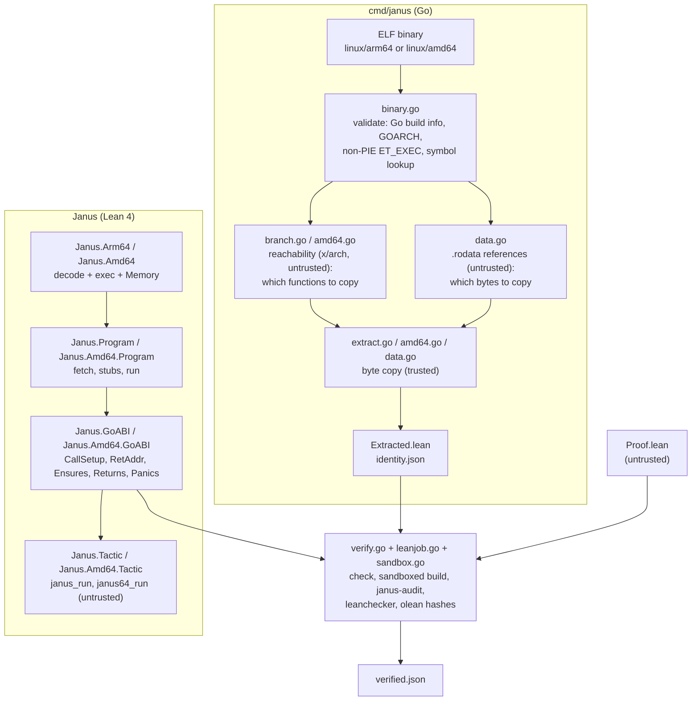

# Architecture

Janus has two halves that meet at one generated file, `Extracted.lean`:

* a **Go command-line tool** (`cmd/janus`) that reads an ELF binary, copies bytes out of it, and
  drives Lean to check proofs about them;
* a **Lean 4 library** (`Janus`) that gives those bytes a meaning: decoders and semantics for arm64 and
  amd64, a checked memory, a model of Go's calling convention, a specification vocabulary, and proof
  automation.

The extractor never interprets an instruction, and the Lean side never trusts the extractor's
analysis. This document explains how that split works. [SOUNDNESS.md](SOUNDNESS.md) states precisely
what a theorem means, and [CLI.md](CLI.md) documents every artifact format.

## Data flow



Step by step, for `janus extract <binary> <symbol> <outdir>` followed by `janus verify <outdir>`:

1. **Validate** (`binary.go`). The file must be a 64-bit little-endian ELF executable (`ET_EXEC`; a PIE
   is rejected because the model uses link-time addresses), with Go build information and
   `GOOS=linux`, `GOARCH=arm64` or `amd64`. Functions come from `.symtab`, or from `.gopclntab` if
   the binary is stripped.
2. **Choose what to copy** (untrusted). Starting at the symbol, follow direct branches and calls
   (`golang.org/x/arch` disassemblers) to the transitive set of callees. Calls into
   `runtime.panic*`, `runtime.goPanic*`, `runtime.gopanic` and `runtime.morestack*` are recorded as
   **stubs** instead of being copied. Scan the copied code for PC-relative references to read-only
   data (`ADRP`+`ADD`/`LDR` on arm64, `[rip+d]` on amd64).
3. **Copy** (trusted). For each function, copy the raw bytes of `[addr, addr+size)` from `.text`:
   little-endian 32-bit words on arm64 (trailing zero padding dropped), raw bytes on amd64. Copy the
   referenced read-only data byte for byte. Writable globals are never copied: their run-time
   contents are not fixed by the binary.
4. **Render** `Extracted.lean` (a `Program` value: segments, stubs, data, entry address) and
   `identity.json` (binary SHA-256, extractor version, symbol, functions, stubs, data, and the SHA-256
   of `Extracted.lean`).
5. **Verify.** `janus verify` re-runs steps 1–4 in memory against the binary (checked by SHA-256) and
   byte-compares the result with the saved files. It then compiles a trusted copy of `Extracted`,
   compiles the proof in a sandbox, audits the theorem with the trusted `janus-audit` routine, replays the
   environment with `leanchecker`, re-checks every hash, and writes `verified.json`. The full list of
   steps is in [CLI.md § Verify](CLI.md#verify).

## Why decoding in Lean keeps the extractor out of the TCB

An extractor that *translated* machine code into Lean terms would be a compiler whose output you
have to trust: a translation bug could hand the prover a different program from the one in the
binary, and no proof would notice. Janus avoids that by making the extractor's output **data**, not
code:

```lean
def segments : List Segment := [
  { name := "example.com/basic.Add", base := 0x930c0, words := [0x8b010000, 0xd65f03c0] } ]
```

Meaning is assigned only inside Lean, on every step, by the same model that the oracles test:

```lean
def run (p : Program) : Nat → State → Except Fault Outcome
  | 0, _ => .error .outOfFuel
  | fuel + 1, s =>
    let pc := s.pc.toNat
    if pc = p.exitAddr then .ok (.returned s) else
    match p.stubAt pc with
    | some st => .ok (.stub st.name st.kind s)
    | none =>
      match p.fetch pc with
      | none => .error (.noCode pc)
      | some w => do
        let s' ← Arm64.step w s       -- decode w, then execute it
        run p fuel s'
```

What remains trusted on the Go side is small and mechanical: find a symbol, copy its bytes, hash.
Every analysis that *could* be wrong in an interesting way only decides what to copy, and each error
is conservative:

| Untrusted analysis | If it is wrong | Effect on a proof |
|---|---|---|
| reachability (`branch.go`, `amd64.go`) | a callee is not copied | the run hits `noCode`; the theorem becomes unprovable |
| data references (`data.go`) | a `.rodata` object is not copied | `DataLoaded` does not provide it; the load faults (`outsideAllocation`) |
| `arm64asm` disassembly in `janus blockers` | a word is mislabelled | informational only; `blockers` asks the Lean decoder (`janus-decode`) which words it rejects |

None of them can make a false theorem provable. The symbolic executor (`janus_run`) is untrusted in
the same way: it calls the Lean model, and every fact it uses about the concrete program, "the word at
this `pc` is `w`, it decodes to this instruction, this address is neither the exit nor a stub", is one
Boolean (`stepOK`) closed by kernel evaluation. A tactic bug makes a proof fail; the kernel rejects
any proof term that does not check.

## The model: programs, states, outcomes

### Program

```lean
structure Program where
  segments : List Segment      -- one per copied function: name, base address, words
  stubs    : List Stub         -- runtime functions that end the run: name, address, kind
  exitAddr : Nat               -- where a return lands; specs replace it (see below)
  data     : List DataSegment  -- read-only bytes the code loads (.rodata, literal pools)
```

`Program.fetch` finds the word at an address in some segment. Code is not memory: instructions are
fetched from `segments`, never from the state's memory, so stores cannot change the code.
`Program.DataLoaded p m` is the precondition that memory holds `p.data` in read-only regions.

`Amd64.Program` is the same shape with byte segments. It reuses `Stub`, `StubKind` and
`DataSegment`, and its `fetch` returns the at most 15 bytes from `RIP` to the end of the segment (an
instruction is never stitched together across two segments).

### State

| | arm64 (`Janus.Arm64.State`) | amd64 (`Janus.Amd64.State`) |
|---|---|---|
| registers | `X0`–`X30`, `SP`, `pc` | 16 GPRs (encoding order), `RIP`, `XMM0`–`XMM15` |
| flags | `NZCV` | six status flags, each `some b` or `none` (architecturally undefined) |
| memory | `Janus.Arm64.Memory` | the **same** `Janus.Arm64.Memory` |

`Memory` is a byte map plus the list of **regions** the caller owns:

```lean
structure Region where base : Nat; size : Nat; writable : Bool
structure Memory where bytes : Nat → Byte; regions : List Region
```

A load or store of `n` bytes at `a` is allowed only if `[a, a+n)` lies inside one region ending at or
below `2^48` (the Linux user address limit), the region is writable for a store, and a store touches
no read-only region at all. Otherwise the step faults. This is why a theorem about pointer code
must say which memory the caller provides, and why "no out-of-bounds access" is not a separate
property: it is part of returning.

### Step and outcome

`step` decodes one instruction and executes it, producing `Except Fault State`. There is no
undefined behaviour in the model: anything the model does not support or cannot give a meaning to is a
named `Fault`:

| Fault | arm64 | amd64 | Meaning |
|---|:-:|:-:|---|
| `undecodable` | ✓ | ✓ | the word/bytes are outside the supported subset, or reserved / UNPREDICTABLE |
| `noCode` | ✓ | ✓ | `pc` is in no copied segment and at no stub |
| `outsideAllocation`, `readOnly` | ✓ | ✓ | a memory access outside the caller's regions, or a store to read-only bytes |
| `spMisaligned`, `pcMisaligned` | ✓ | | SP-relative access with SP not 16-aligned; misaligned branch target |
| `undefinedFlag`, `undefinedResult` | | ✓ | an instruction reads a flag the SDM leaves undefined, or has an undefined result |
| `divideError`, `misaligned`, `badTarget` | | ✓ | `#DE`; misaligned 16-byte SSE operand; branch target `≥ 2^47` |
| `outOfFuel` | ✓ | ✓ | the run did not finish within the fuel bound |

(See `Janus/Arm64/State.lean` and `Janus/Amd64/State.lean` for the complete, current lists.)

`Program.run fuel s` repeats `step` until `pc` reaches `exitAddr` (`.returned s'`), reaches a stub
(`.stub name kind s'`), faults, or runs out of fuel. `Janus/Run.lean` proves the fuel lemmas that make
results fuel-independent (`run_mono`, `run_ok_unique`) and the composition lemma `run_steps`.

### Calls and specifications (`Janus.GoABI`)

The outcome predicates are defined on `run`:

| Predicate | Definition, informally |
|---|---|
| `Returns p s post` | some fuel gives `.returned s'` with `post s'` |
| `Panics p s` | some fuel reaches a `.panic` stub |
| `Faults p s` | some fuel gives a fault other than `outOfFuel` |
| `NeverPanics p s` | for every fuel: no panic stub and no fault (`neverPanics_iff : NeverPanics ↔ ¬ Panics ∧ ¬ Faults`) |
| `GrowsStack p s` | some fuel reaches `runtime.morestack*` |

A Go call is described by `CallSetup p entry args s`: `pc = entry`, the link register (`X30` on
arm64, the word at `[RSP]` on amd64) holds `p.exitAddr`, and the integer arguments sit in Go's
ABIInternal argument registers (`X0, X1, …` on arm64; `RAX, RBX, RCX, RDI, RSI, R8, …` on amd64).
Everything else is arbitrary.

The extracted `exitAddr` is a placeholder `0`. Specifications never rely on it, because a computed
jump to `0` (through a nil code pointer, say) would then count as a return. Instead `Ensures`
quantifies over **every** admissible return address:

```lean
def Ensures (p : Program) (entry : Nat) (args : List W64) (pre : State → Prop)
    (post : State → State → Prop) : Prop :=
  ∀ ret, RetAddr p ret → ∀ s, CallSetup (p.withExit ret) entry args s → pre s →
    Returns (p.withExit ret) s (fun s' => ABIReturn s s' ∧ post s s')
```

`RetAddr p ret` says `ret` is aligned, a user address, outside every copied segment and not a stub:
exactly the properties of the instruction after a real `BL`/`CALL` in a caller outside the extracted
code. Since the theorem holds for every such `ret`, only a return through the value the caller
actually stored can reach it. `ABIReturn` adds the callee's obligations: on arm64 `SP`, `g` (`X28`),
the frame pointer (`X29`) and `X18` are restored; on amd64 `RSP` is popped by 8 and `RBP`, `R14` (g)
and `X15` are restored.

### Specification vocabulary

`Janus.Spec` (arm64) provides the predicates proofs use for memory: `Ptr m p n w` (the `n` bytes at
`p` lie in one region, writable if `w`, below `2^48`), `Disjoint`, `Aliasing` (equal or disjoint),
`OnlyWrites m m' p n` (nothing outside `[p, p+n)` changed), `val256`, `sumWords`, `copyWords`, and
`StackOK`/`GuardOK` for frames and the stack-growth prologue. `Janus.Amd64.GoABI` has the amd64
counterparts (`Buffer`, `Disjoint`, `valueAt`, `StackWritable`, `StackGuardOK`).

## How the two ISAs share the framework

| Shared | Per ISA |
|---|---|
| `Janus.Arm64.Memory`, its regions, bounds and `MemoryLemmas` (amd64 aliases it as `Janus.Amd64.Memory`) | registers, flags, `Instr`, `decode`, `exec` |
| `Stub`, `StubKind`, `DataSegment`, the `Outcome` shape | `Program` (words vs bytes) and `fetch` |
| The meaning of `Returns`, `Panics`, `Faults`, `NeverPanics`, `GrowsStack`, `Ensures`, `RetAddr` (same names and definitions over each ISA's `run`) | `CallSetup`, `ABIReturn` and the register assignment of ABIInternal |
| The run lemmas (`Janus/Run.lean` and its copy `Janus/Amd64/Run.lean`) | the tactics: `janus_intro`/`janus_run` vs `janus64_intro`/`janus64_run` |
| The whole CLI: `list`, `extract`, `check`, `verify`, `explain`, the identity and report formats, the sandbox and audit | `blockers` is arm64-only; `identity.json` adds `goamd64` and per-function `bytes` on amd64 |

`janus` picks the backend from the ELF machine type (`EM_AARCH64` or `EM_X86_64`) and the Go build
setting `GOARCH`, and renders `Extracted.lean` with `Program` or `Amd64.Program` accordingly. A proof
imports `Extracted` either way.

## Module map

### Lean (`Janus`, the framework embedded in `janus`)

| Module | Role | Trusted? |
|---|---|:-:|
| `Janus.Arm64.State` | registers, flags, `Memory` with checked `load`/`store`, `Fault` | **yes** |
| `Janus.Arm64.Instr`, `Janus.Arm64.Decode` | A64 instruction AST and decoder (rejects reserved/UNPREDICTABLE encodings) | **yes** |
| `Janus.Arm64.Exec`, `Janus.Arm64.Bits` | A64 semantics, following ARM ARM pseudocode | **yes** |
| `Janus.Program` | `Program`, `fetch`, `stubAt`, `DataLoaded`, `run` | **yes** |
| `Janus.Arm64.MemoryLemmas`, `Janus.Run` | read-over-write, frame and fuel lemmas (proved) | no |
| `Janus.GoABI` | ABIInternal on arm64: `CallSetup`, `RetAddr`, `ABIReturn`, outcome predicates, `Ensures` | definitions are part of every statement |
| `Janus.Spec.Basic` | `Ptr`, `Disjoint`, `Aliasing`, `OnlyWrites`, `val256`, `StackOK`, … | definitions are part of every statement |
| `Janus.Tactic.{Attr,Basic,Core,Data}` | `Reaches`, `Summary`, `janus_run`, `janus_data`, simp sets | no |
| `Janus.Amd64.{State,Instr,Decode,Exec,Program}` | the x86-64 model | **yes** |
| `Janus.Amd64.{Run,GoABI,Tactic,TacticAttr}` | amd64 lemmas, ABI, `janus64_run` | ABI definitions as above; tactics no |
| `Janus.Tools.Audit` | `janus-audit`: theorem lookup, axiom collection, statement rules, clean-environment printing | **yes** |
| `Janus.Tools.Decode` | `janus-decode`: runs the arm64 decoder over words, for `janus blockers` | (uses the trusted decoder) |

Outside the framework: `JanusTests` (concrete-execution and tactic tests), `Oracle/Main.lean` and
`Oracle/Amd64Main.lean` (the Lean side of the differential oracles), and `JanusASL/` (work in progress
on an ASL-derived check).

### Go (`cmd/janus`)

| File | Role | Trusted? |
|---|---|:-:|
| `main.go`, `extra.go` | command dispatch | |
| `binary.go` | ELF validation, symbols from `.symtab`/`.gopclntab`, section access | **yes** |
| `extract.go`, `amd64.go` | the byte copy and `Extracted.lean` rendering | **yes** (copy) |
| `branch.go`, reachability in `amd64.go` | which callees to copy | no |
| `data.go` | read-only data references (untrusted) and their byte copy (trusted) | partly |
| `identity.go` | `identity.json`, `janus check` (regenerate and byte-compare) | **yes** |
| `verify.go`, `leanjob.go` | the verify pipeline: trusted copies, proof build, audit, replay, hashes, report | **yes** |
| `replay.go` | framework olean pins, the import-closure check, the cached kernel replay of every non-core module | **yes** |
| `sandbox.go` | bubblewrap / `unshare` confinement of every Lean process that loads proof code | **yes** |
| `framework.go`, `../../framework.go` | the embedded Lean framework (`go:embed`), its materialisation and cache | **yes** |
| `consumer.go`, `batch.go`, `init.go` | consumer Lake packages, `verify-batch`, `janus init` | |
| `explain.go`, `blockers.go` | `janus explain`, `janus blockers` | |

### Oracles and audit

| Directory | What it is |
|---|---|
| `oracle/` | arm64 differential oracle vs qemu or native hardware ([ORACLE.md](ORACLE.md)) |
| `oracle-sail/` | the same corpus on the Sail arm-v9.4-a model of Arm's ASL ([ORACLE-SAIL.md](ORACLE-SAIL.md)) |
| `oracle-amd64/`, `oracle-amd64-formal/` | amd64 oracle on the host CPU, and the Sail/ACL2 X86isa flag cross-check ([ORACLE-AMD64.md](ORACLE-AMD64.md)) |
| `audit/` | the attack files behind [AUDIT.md](AUDIT.md) and `run-all.sh` |

## Where the trust boundary runs inside `janus verify`

The proof is treated as hostile code, so the verifier is arranged so that nothing the proof does can
change the result it reports:

* `Extracted` is compiled from the **checked** bytes into a private directory, together with an
  independently elaborated, namespace-renamed copy `JanusTrusted`, before any proof code runs. That
  directory comes first on an otherwise private `LEAN_PATH`.
* The proof is compiled in a sandbox with a read-only filesystem except one fresh build directory.
* `janus-audit` (`Janus.Tools.Audit`, run from a script that imports only that module) loads the
  compiled proof with `importModules` **without running its initializers**, checks that
  `Extracted.program` and `entry` are kernel-defeq to `JanusTrusted`, collects axioms, enforces which
  constants the statement may mention, and prints the statement in an environment that imports only
  `Janus` and `Extracted`.
* `leanchecker` replays the environment independently, and every `.olean` hash is re-checked after the
  audit and the replay.

[AUDIT.md](AUDIT.md) describes the attacks this arrangement was built against.
